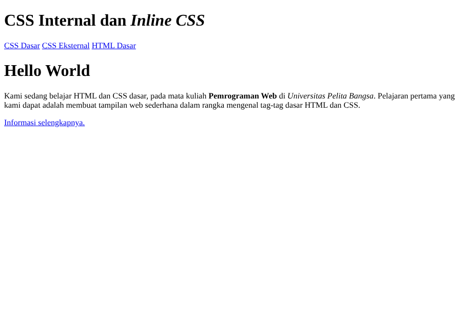
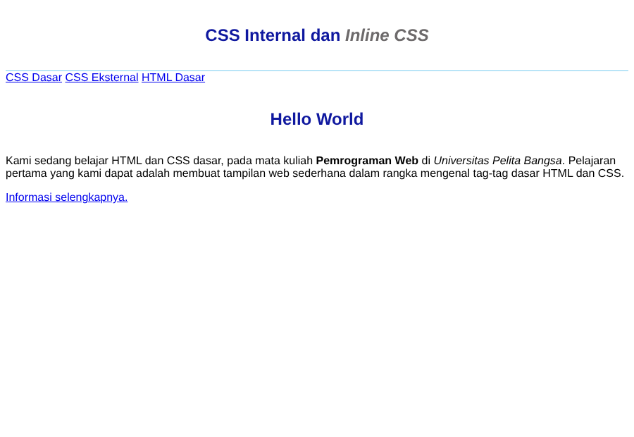
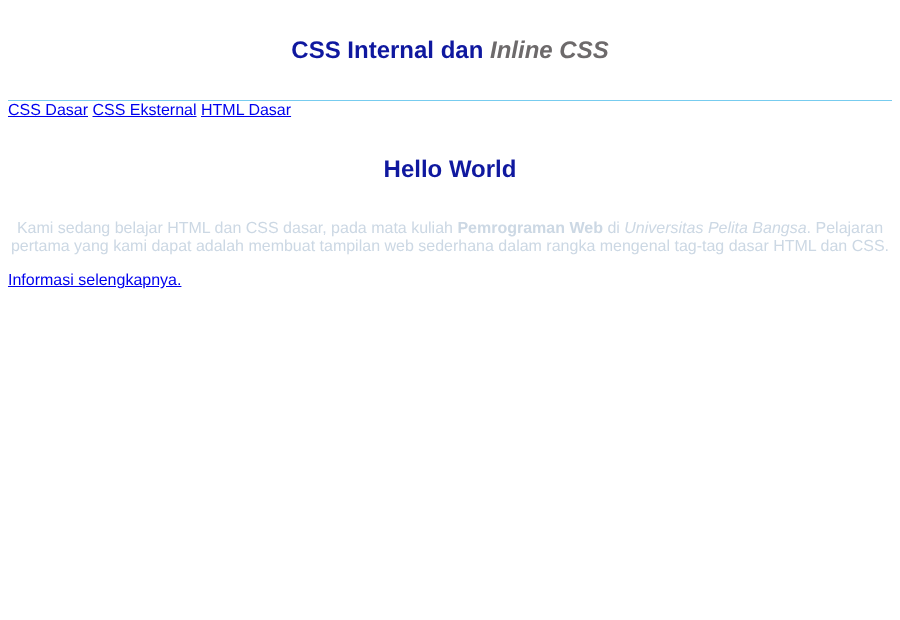
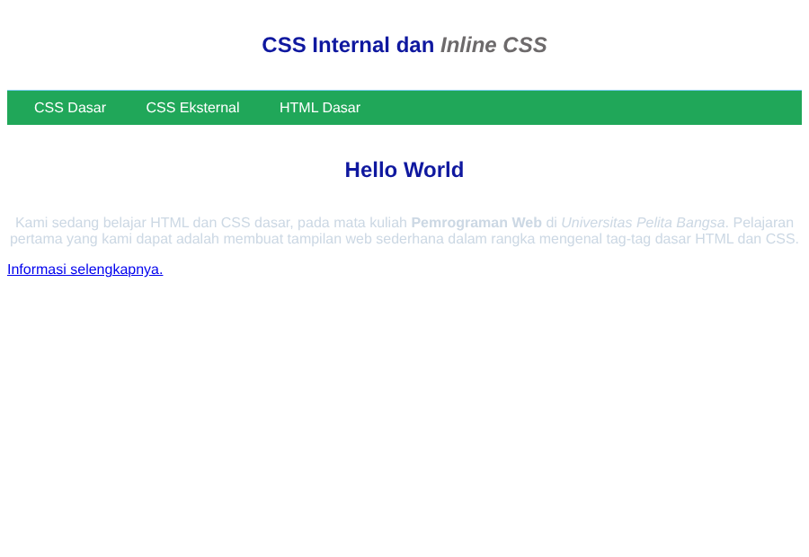
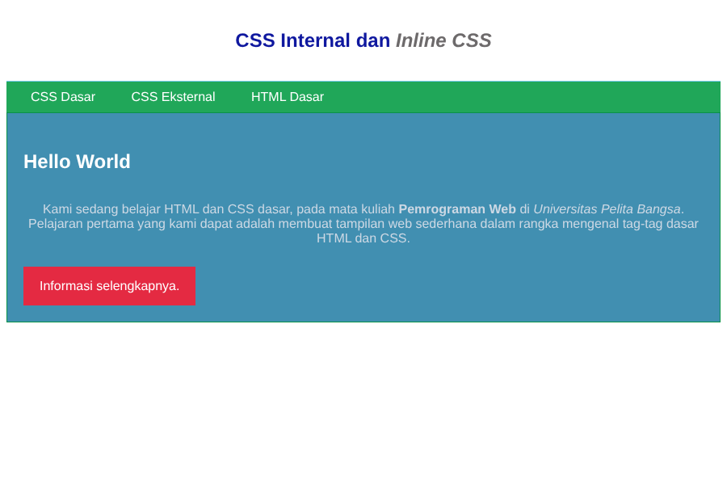
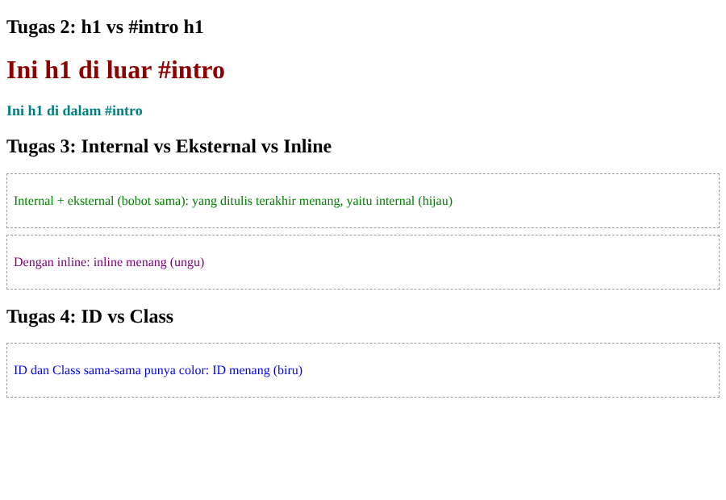

# Lab3Web - Praktikum 3: CSS Dasar

Mata kuliah: Pemrograman Web (IFE306) - Universitas Pelita Bangsa

**Nama:** (isi nama Anda)
**NIM:** (isi NIM Anda)
**Kelas:** (isi kelas Anda)

## Struktur Repository

```
Lab3Web/
├── lab2_css_dasar.html     # dokumen HTML utama (internal + inline + link eksternal)
├── style_eksternal.css     # CSS eksternal (nav, ID selector, class selector)
├── tugas_demo.html         # demo untuk pertanyaan 2, 3, dan 4
├── demo_eksternal.css      # CSS eksternal untuk demo
├── screenshots/            # hasil screenshot tiap langkah
└── README.md
```

## Langkah Praktikum

### 1. Membuat Dokumen HTML

Dibuat file `lab2_css_dasar.html` dengan struktur dasar HTML5: `header`, `nav` (tiga link), dan `div#intro` yang berisi heading, paragraf, serta link bertombol (`class="button btn-primary"`). Pada tahap ini belum ada CSS sehingga tampilan masih default browser.



### 2. Mendeklarasikan CSS Internal

Ditambahkan tag `<style>` di dalam `<head>` dengan aturan untuk `body` (font), `header` (tinggi minimum dan garis bawah), `h1` (ukuran, warna, rata tengah, padding), dan `h1 i` (warna teks miring). Heading menjadi biru, rata tengah, dan teks *Inline CSS* menjadi abu-abu.



### 3. Menambahkan Inline CSS

Atribut `style="text-align: center; color: #ccd8e4;"` ditambahkan pada tag `<p>`. Inline CSS hanya memengaruhi elemen tempat atribut itu ditulis, sehingga paragraf menjadi rata tengah dengan warna biru muda.



### 4. Membuat CSS Eksternal

Dibuat file `style_eksternal.css` berisi aturan `nav`, `nav a`, dan `nav .active, nav a:hover`, lalu dihubungkan lewat `<link rel="stylesheet" href="style_eksternal.css" type="text/css">` di dalam `<head>`. Menu navigasi tampil dengan latar hijau dan teks putih tanpa garis bawah.



### 5. Menambahkan CSS Selector (ID dan Class)

Pada `style_eksternal.css` ditambahkan:

- **ID selector** `#intro` dan `#intro h1`: latar biru, border hijau, padding, serta heading putih rata kiri tanpa border.
- **Class selector** `.button` dan `.btn-primary`: link tampil sebagai tombol merah dengan teks putih.



### Validasi CSS

Kode CSS dapat divalidasi di https://jigsaw.w3.org/css-validator/ dengan mengunggah `style_eksternal.css` atau menempel isi `<style>`. (Tambahkan screenshot hasil validasi Anda di sini setelah mengunjungi situs tersebut.)

## Pertanyaan dan Tugas

### 1. Eksperimen properti CSS

Properti dan nilai dapat diubah langsung pada `style_eksternal.css` atau blok `<style>`, misalnya mengganti `background`, `font-size`, `padding`, `border-radius`, atau menambah `font-weight`, `box-shadow`, lalu refresh browser untuk melihat hasilnya. (Tambahkan eksperimen dan screenshot Anda sendiri dengan mengacu pada CSS Cheat Sheet.)

### 2. Perbedaan `h1 {...}` dengan `#intro h1 {...}`

- `h1 {...}` adalah **selector elemen**: berlaku untuk **semua** elemen `<h1>` di halaman.
- `#intro h1 {...}` adalah **selector turunan (descendant)** yang dibatasi ID: hanya berlaku untuk `<h1>` yang berada **di dalam** elemen ber-`id="intro"`.
- `#intro h1` lebih **spesifik**, sehingga jika bertabrakan dengan `h1 {...}`, aturan `#intro h1` yang dipakai. Itulah sebabnya `Hello World` menjadi putih rata kiri, sementara h1 di header tetap biru rata tengah.

Contoh: `h1` di luar `#intro` tampil merah tua (aturan `h1`), sedangkan `h1` di dalam `#intro` tampil teal dan lebih kecil (aturan `#intro h1`).



### 3. Internal, eksternal, dan inline pada elemen yang sama

**Inline CSS yang ditampilkan** (menang atas internal maupun eksternal), karena specificity inline paling tinggi.

Jika internal dan eksternal memiliki selector yang sama (specificity sama), yang **ditulis/dimuat terakhir** yang menang. Pada demo, `<link>` eksternal ditulis lebih dulu daripada `<style>` internal sehingga internal menang (hijau); bila urutannya dibalik, eksternal yang menang. Jika ada atribut inline (`style="color: purple;"`), hasilnya selalu ungu.

Urutan prioritas: **inline > internal/eksternal (yang terakhir menang)**. (Pengecualian: deklarasi dengan `!important`.)

### 4. ID dan Class pada elemen yang sama

Untuk `<p id="paragraf-1" class="textparagraf">`, deklarasi **ID selector** yang ditampilkan, karena specificity ID (1-0-0) lebih tinggi daripada class (0-1-0), berapa pun urutan penulisannya.

```css
#paragraf-1 { color: blue; }
.textparagraf { color: orange; }
```

Hasilnya teks berwarna **biru** (lihat screenshot demo di atas).

## Cara Menjalankan

Buka `lab2_css_dasar.html` dan `tugas_demo.html` langsung di browser.
